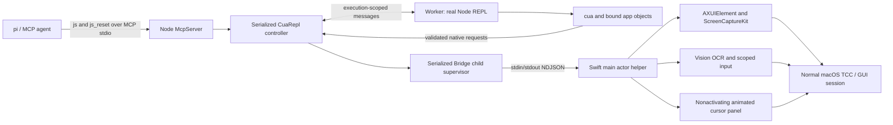

# Independent implementation



The implementation does not import, launch or connect to a Codex component. `src/server.mjs` exposes only `js` and `js_reset` through the MCP SDK stdio transport. `src/repl.mjs` owns execution serialization, deadlines, generation IDs and one `src/bridge.mjs` helper supervisor. `src/repl-worker.mjs` uses Node's real REPL evaluator, retaining lexical var/let/const bindings, top-level await and app objects across calls. It captures console/REPL output without mixing it into MCP stdout; `nodeRepl.emitImage` produces native MCP image blocks.

`src/cua.mjs` implements inventory, exact PID/window binding, app observations and mutations. Each object owns its latest AX tree/diff and screenshot scale. After screenshot observation, array coordinates use screenshot pixels; AX-only observations reset arrays to logical window points. Resize invalidates mappings. `src/tools.mjs` validates internal native request contracts; those methods are not separately exposed MCP tools.

The worker is a trusted local Node environment, not a security sandbox. AsyncLocalStorage tags native requests with the originating evaluation; callbacks from a completed execution cannot borrow the next execution's authority. Already-issued operations drain before completion. Timeout, cancellation or reset terminates the worker, invalidates queued executions and retires the native helper before another execution starts. Side effects already delivered are not rolled back.

The independent cursor is an AppKit NSPanel that cannot become key/main, ignores mouse events and accepts no input. Two draw styles share the same panel, anchor and lifecycle: the default `arrow` draws a standard macOS pointer with a black fill, white outline and a small highlight while pressed, while `ring` draws an amber reticle with crosshair ticks whose shape and color do not read as a pointer. `CU_AGENT_CURSOR_STYLE` selects the style, an unknown value falls back to `arrow`, and `cursorState` reports the effective `style`/`styleDescription`. Eased intermediate positions run at about60Hz; the action waits for arrival. Real drag packets drive the cursor's pressed position. Window movement updates its location; resizing/hidden targets/exit/reset/disconnect/idle hide it. Text and semantic actions point at an element center, not a measured caret. It never warps the hardware pointer. The cursor approach completes before any optional app-local focus scope, enforced by timestamps in the real-document test.

The internal protocol intentionally differs from the original socket framing. The helper is a direct child with inherited anonymous stdin/stdout pipes; there is no shared socket, public port, discovery token or authentication secret. One UTF-8 JSON object per newline:

```json
{"id":1,"method":"snapshot","params":{"pid":123,"windowId":456,"screenshot":false}}
{"id":1,"result":{"snapshotId":"UUID","nodes":[],"truncated":false}}
```

An error replaces `result` with `{"error":{"code":"STALE_ELEMENT","message":"..."}}`. MCP execution errors set `isError:true`; error codes and messages remain available to the caller. Native helpers do not speak MCP directly. IDs must match the active request; a malformed response tears down the helper.

The Swift app's main thread owns AppKit/AX objects and all GUI actions. A background reader dispatches one request to a main-actor task and waits for completion. ScreenCaptureKit and focus polling can suspend without blocking the main runloop. AX calls have a one-second per-element messaging timeout; a 30-second outer timeout bounds a stuck operation. All actions are single-request operations; there are no persistent held-key or drag handles.

Snapshots bind an opaque UUID to a table of AX object references, PID, CGWindowID, role, optional AX identifier and window/menu scope. Before an action the helper verifies the live app, the current CG window, AX identity and current ancestry. It does not resolve stale numeric IDs against a newer tree. AX windows map to CG windows by documented geometry properties; ambiguous matches are rejected. No private `_AXUIElementGetWindow` is used. Window-routed pointer input separately uses the dynamically resolved undocumented CGEventSetWindowLocation entrypoint; it is isolated in native/Background.swift.

Tree traversal handles AX cycles and hash collisions, bounds node count/depth/time, omits secure-field values and limits long strings. Unsupported AX attributes are omitted. AX remains application-supplied accessibility data, and snapshots are not an atomic rendering transaction. A malicious or broken app can expose misleading AX content. Follow-up snapshots are needed after meaningful actions.

Actions default to background. AX text insertion reads the original value and UTF-16 selection, checks writability, inserts through AXSelectedText or AXValue and verifies exact read-back. CMD+A uses verified AXSelectedTextRange where supported; app.pressKey with strategy:event forces actual CGEvent keys, including CMD+A, without a semantic fallback. Explicit text strategy:event sends bounded Unicode CGEvent packets to an already-focused editable element and acknowledges each packet with exact UTF-16 readback; newline/tab controls are isolated and no failed packet is replayed. Other keyboard events are process-directed best effort, with explicit verificationRequired rather than a success claim about UI behavior.

Background single clicks prefer AXPress on the exact element or a control resolved inside the target window's AX hierarchy. Global AX hit-testing would see the cover and is never used in this route. strategy:ax requires this semantic action; strategy:event forces pointer events; auto falls back only to window-directed events, never foreground input.

Pointer events are built with NSEvent, assigned an isolated CGEventSource, exact window carriers (91/92 and undocumented 51), a window-local location through dynamically resolved CGEventSetWindowLocation, then posted only to the target PID. Background input does not call activate, AXRaise, CGWarpMouseCursorPosition or global HID posting. The prototype's app-local activation notifications were removed after concurrent foreground typing lost characters despite an unchanged foreground PID. Default routing does not synthesize activation, suppress focus notifications or inject remote code. The separately enabled scoped route is described below. A source-filtered target-process tap removes a temporary Command routing flag from only the helper's exact operation/window packets before AppKit delivery; acknowledgement is required for each pointer packet. The event source and event number are retained for a gesture. Some AppKit editing windows still reorder themselves on raw mouse events; foreground and stacking changes are reported without restoration. These checks cannot guarantee absence of every transient app-specific reaction.

Explicit foreground operations raise the exact window, verify focus and hit-test the target. The JavaScript API exposes `app.hover` with `CU_ENABLE_FOREGROUND=1`. Other foreground methods remain internal. Background operations keep their window-scoped route. Text selection uses UTF-16 ranges and disambiguates repeated substrings. The backend rejects background app-menu actions and known closed popups that only expose native menu tracking.

Each helper separately tracks foreground and process/window-scoped drag buttons. SIGTERM on the main queue releases the held button through its original route and terminates. The parent invalidates queued calls from the old generation, waits for exit before a fresh helper starts, and escalates to SIGKILL after one second. Cancellation or timeout can still leave partial effects. Hard termination during a blocked OS call cannot guarantee cleanup; no system-level transactional input guarantee is claimed.

ScreenCaptureKit obtains one requested window or display image without writing screenshots to disk. PNG bytes appear once as MCP image content; metadata appears as structured/text content. OCR uses the same capture pipeline and converts Vision's lower-left normalized boxes into top-left logical points. Full-display capture is unavailable in app-allowlist mode. Window capture may include app-owned sheets or popovers according to ScreenCaptureKit behavior; no redaction beyond the OS-provided image is performed.

Security scope: the service has the launching user's desktop privileges and is intended for trusted local agents. `CU_ALLOWED_BUNDLE_IDS` narrows tool behavior, not shell privileges; clients with filesystem access can change the server. There is no remote transport, implicit authorization UI, account integration or credential store. The calling agent owns user-intent handling and confirmation policy.

The current development tree also has an explicitly opt-in CU_EXPERIMENTAL_APPKIT_FOCUS=1 route for raw click/drag, text and nonsemantic key operations. It reads the window's AXActivationPoint, emits observed app-local activation/key-focus notices, performs an acknowledged activation-point click, and cleans up its local state. Raw text requires the exact pre-existing editable focus and rejects selection changes during preparation. It skips synthetic deactivation if the user has actually switched to the target. This experimental path is restricted to macOS 26.6.2 arm64, has separate result metadata, and passes a covered first-party document test with real Unicode, keys, click, selection drag and scroll. The v1 manual IME baseline/background comparison passed after moving cursor animation before the local focus scope. It records experience and source/modifier metadata, not exact foreground character readback. Stock Calculator/TextEdit operation tests belong to the historical v0.3 backend; arbitrary app and ViewBridge behavior remains unproven. Default operation does not use it. The original ViewBridge suppression/rerouting state machine remains unported.
