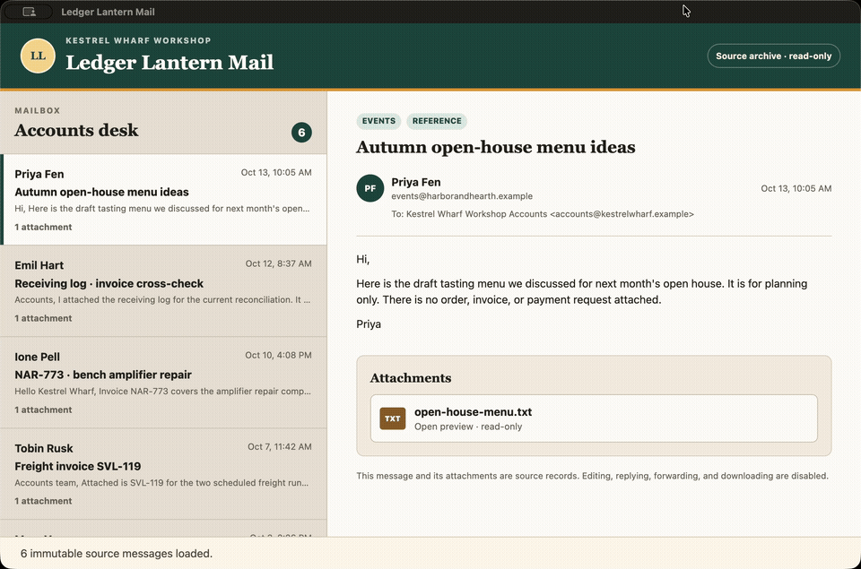
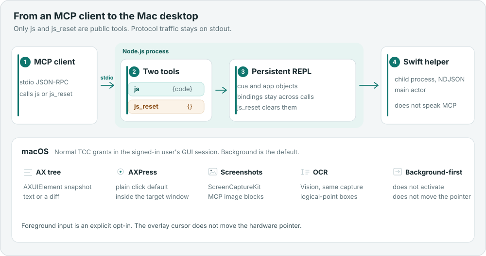
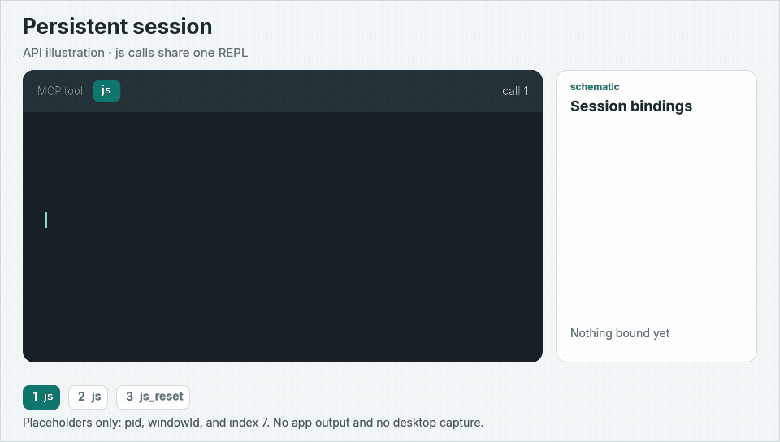

# macOS Computer Use MCP

[English version](../../README.md)

用持久的 JavaScript 会话编写 macOS 应用脚本——只需两个 MCP 工具。



这是钉选的 Ledger Lantern Mail 夹具的一次实时运行。默认箭头光标会移到每个目标。`js` 读取辅助功能树，再用后台 `AXPress` 打开 Freight invoice SVL-119 和附件 SVL-119.txt。重新录制：`node scripts/record-readme-demo.mjs`（需先 `npm run build` 和 `npm run bench:v2 -- --prepare`）。



公开路径：MCP 客户端经 `js` 和 `js_reset` 进入同一个持久 REPL，再由 Swift helper 接触 macOS。内部结构见[架构说明](../ARCHITECTURE.md)（仅英文）。

变量、函数和应用句柄在多次工具调用之间保留。一次调用观察窗口，下一次调用继续使用同一批对象。原生 Swift helper 提供 Accessibility 树、截图、OCR，以及以后台为先的交互。

灵感来自 Codex 风格的 JavaScript computer-use 会话。这是独立实现，不是官方 Codex 集成。它作为可信的本地 Node.js 进程运行，不是安全沙箱。

## 两个工具，一个会话

公开服务只暴露 `js` 和 `js_reset`。`cua` 与 `nodeRepl` 已经初始化。顶层 `await`、`var` / `let` / `const`、函数和应用对象在下一次 `js` 调用中仍然可用。

| 工具 | 参数 | 行为 |
| --- | --- | --- |
| `js` | `{code, timeout_ms?, title?}` | 在持久的 Node.js REPL 中执行 `code`。`timeout_ms` 可选，默认 30000，必须是 100 到 120000 的整数。 |
| `js_reset` | `{}` | 停止进行中的 JavaScript 与原生输入，隐藏代理光标，并清除词法绑定和应用对象。 |

观察会自动附带 Accessibility 文本或差分；若返回截图，还会附带 MCP 图像块。传入 `emit:false` 只返回值、不附带这些展示。方法、坐标规则和光标见 [JS API](JS_API.md)。

### 什么会留下来，失败时又会清掉什么

- 普通抛出的错误会保留已经存在的绑定。重复声明已有的 `let` 或 `const` 会抛出 `SyntaxError`。
- `js_reset`、超时、客户端取消、进程退出，或输出/内存上限，都会重建会话。这些路径丢掉变量、函数和应用对象，并停止该会话的原生输入。
- 已经送达应用的点击、按键和文本不会回滚。
- 每个桌面操作都要 await。`js` 调用结束后才运行的回调，不能在之后的调用里继续操作桌面。
- 单次调用最多返回 8 MiB 或 256 个块。控制台和 worker 的 stdout 不进入 MCP 协议 stdout。

## 环境要求

从本仓库构建需要：

- macOS 14.4 或更高版本，以及 Xcode Command Line Tools，用于编译 Swift helper
- MCP 服务器需要 Node.js 22 或更高版本。开发检查使用 Node.js 22.13 及以上的 22.x 版本，或 Node.js 24 及以上版本。

已记录的验证环境是 macOS 26.6.2 arm64、Node.js 24.15.0。其他操作系统和架构没有实机验证。`npm run package` 可以在本地生成插件 ZIP；该 ZIP 只需要 macOS 和 Node.js，不需要编译器或 `npm install`。本仓库有 `v1.0.0` 至 `v1.3.0` 标签，不发布 GitHub Releases。这些本地包的验收见[验证记录](VALIDATION.md)。

请在系统设置中，把辅助功能（Accessibility）和屏幕录制授给实际启动服务器的终端、Agent 或 helper。本项目不能替你修改 TCC 数据库。启动链变化后，重新运行 doctor。

服务器进程拥有启动它的用户的桌面权限。它是可信的本地 Node.js 进程，不是安全沙箱，只应执行你信任的 Agent 提供的 JavaScript。

## 安装、构建与 doctor

在本仓库的检出目录中操作。下面的示例把检出目录写成 `macos-computer-use-mcp`；如果克隆下来的目录名不同，请换成实际路径。

```sh
npm ci --ignore-scripts
npm run build
npm run doctor
node /absolute/path/to/macos-computer-use-mcp/src/server.mjs
```

`npm run doctor` 向已构建的 helper 查询状态并打印 JSON。它不会弹出权限请求，也不会授予权限。最后一条命令启动 MCP stdio 服务并等待客户端 JSON-RPC。它不是交互式 shell，stdout 只保留协议输出。`npm start` 运行同一个 `src/server.mjs` 入口。构建会拒绝覆盖仍在运行的 helper；先关闭其客户端，或另选 `CU_BUILD_DIRECTORY`。

## MCP 客户端配置

把 stdio MCP 客户端指向 Node.js 可执行文件和这份检出：

```json
{
  "mcpServers": {
    "macos-computer-use": {
      "command": "/absolute/path/to/node",
      "args": ["/absolute/path/to/macos-computer-use-mcp/src/server.mjs"]
    }
  }
}
```

[`mcp.json`](../../mcp.json) 是同一服务，供会展开 `PLUGIN_ROOT` 的本地插件客户端使用。[`examples/mcp-client.mjs`](../../examples/mcp-client.mjs) 展示直接的 SDK 会话。可选的 pi 安装只写本项目的 `.pi/mcp.json`，不改全局配置或凭证：

```sh
node scripts/setup-pi.mjs
pi --approve --extension builtin:mcp
```

该安装保持合成 AppKit 激活关闭，即使传入旧的 `--background-events` 参数也是如此。`--experimental-appkit-focus` 才会显式打开旧的激活路径。见[输入隔离](INPUT_ISOLATION.md)。

## 持久会话



下面这段调用的 API 示意，不是屏幕录制。`pid`、`windowId` 和索引 `7` 都是占位符，图中没有应用输出。

第一次 `js` 调用读取当前清单并绑定一个窗口。`state.windows` 的每一项包含 `pid`、`windowId`、`title`、`app`、`bundleId`、`path`、`frame` 和 `onScreen`。`cua.listWindows()` 只返回这个窗口数组。请复制一对真实的值。下面的常量是占位符，不是你这台 Mac 上的窗口。

```js
const state = await cua.getState();
const EXAMPLE_PID = 123;        // 换成 state.windows[].pid
const EXAMPLE_WINDOW_ID = 456;  // 换成对应的 state.windows[].windowId
let app = await cua.getApp({pid: EXAMPLE_PID, windowId: EXAMPLE_WINDOW_ID});
```

`cua.getApp("com.apple.calculator")` 这类 bundle id 只有在恰好匹配一个窗口时才可用。零个或多个匹配都会抛错，而且 `getApp` 不会启动应用。

下一次 `js` 调用仍是同一个 REPL，因此 `app` 还是那个对象：

```js
await app.getAXStateAndScreenshot();
const EXAMPLE_ELEMENT_INDEX = 7; // 换成这次最新观察里的索引
await app.click(EXAMPLE_ELEMENT_INDEX);
```

元素索引指的是该应用对象最近一次观察中的行，不是跨观察稳定的 id。`await app.typeText("...")` 和 `await app.pressKey("CMD+A")` 也在同一会话里。`coordinateMode:"original"` 是移植脚本时显式选择的坐标映射，并不表示其余行为与另一产品一致。细节见 [JS API](JS_API.md)。

## 配置与限制

后台操作默认不激活目标、不移动系统指针，也不回退到前台。窗口可以完全被挡住，但仍须在当前已解锁的桌面且未最小化。锁屏、其他 Space 和隐藏桌面不在支持保证内。默认动作优先使用 `AXPress` 和经过读回校验的 Accessibility 文本。真实鼠标和键盘事件是可选项，依赖未公开的系统行为，包括 `CGEventSetWindowLocation`。应用可能忽略这些事件，或自行重排窗口。隔离错误会停止操作，以便调用方重新观察。

`CU_ALLOWED_BUNDLE_IDS` 限制可操作的应用。空值拒绝所有目标，并禁用显示器截图。`CU_AGENT_CURSOR=0` 隐藏覆盖层。`CU_AGENT_CURSOR_STYLE` 为 `arrow`（默认，标准 macOS 指针）或 `ring`。`CU_AGENT_CURSOR_VISIBILITY` 在 helper 启动时读取：`target`（默认）在锚点被挡住时隐藏或裁剪图形，`always` 保留较早的进度覆盖层。图形隐藏时，移动和后台输入继续。普通截图不含光标；`cua.getScreenshot({region, includeAgentCursor:true})` 可以把它包含进来做视觉检查。见[光标可见性](CURSOR_OCCLUSION.md)。

除非设置 `CU_EXPERIMENTAL_APPKIT_FOCUS=1` 或上面的 pi 参数，实验性的应用内 AppKit 焦点路径保持关闭。它只在已记录的 macOS 26.6.2 arm64 机器上验证过，不能承诺任意应用。没有浏览器 API，也没有富文本粘贴；不支持的选项会明确失败。纯文本粘贴走 Accessibility 插入，不使用剪贴板。只测量过一块物理 Retina 显示器。多显示器坐标公式测试不是多显示器验收。TCC 绕过和凭证提取不属于本项目。

## 基准测试

### Cua Driver Bench v2

`--public-api-only` 复测只使用有文档的 macOS API。SkyLight 焦点查询、原始后台指针投递和实验性 AppKit 路径保持关闭。已复测的 9 个后台种子里，4 个达到综合通过（任务通过、GUI-only，以及 A22 八项全满足）：CDB-G02、CDB-G04、IR-03 和 IR-04。基线中这 9 个种子均未综合通过。每一次复测和基线全部 90 轮都满足 GUI-only。前台的 MB-10 和 MB-11 在下表种子上也达到 1.00。

| 任务 | 条件 | 种子 | 基线 | 复测 |
| --- | --- | --- | --- | --- |
| CDB-G02 | 后台 | `909557` | 0.20 | 1.00 |
| CDB-G04 | 后台 | `482045` | 0.15 | 1.00 |
| IR-03 | 后台 | `410255` | 0.40 | 1.00 |
| IR-04 | 后台 | `816494` | 0.45 | 1.00 |
| MB-10 | 前台 | `227159` | 0.10 | 1.00 |
| MB-11 | 前台 | `160721` | 0.05 | 1.00 |

没有不打扰用户的公开 API 投递路径时，驱动在投递前拒绝并返回明确错误码，而不是报告成功。MB-09 的原生表格行拖动返回 `BACKGROUND_NATIVE_ROW_DRAG_UNSUPPORTED`（种子 `790113` 仍为 0.05，A22 八项通过）。CDB-G03 的 GnuCash 对账对话框返回 `BACKGROUND_GNUCASH_DIALOG_UNSUPPORTED`（种子 `99589` 仍为 0.45，A22 八项通过）。IR-01/02 关闭状态的原生下拉框返回 `BACKGROUND_POPUP_UNSUPPORTED`；显式 `AXShowMenu` 返回 `BACKGROUND_MENU_UNSUPPORTED`。IR-01 `147201` 仍为 0.15，测试应用打开 sheet 时自行激活，A22 从 8/8 降到 4/8。驱动对该次点击返回错误，并停止后续输入。

这些是单次同种子复测（thinking `high`，基线为 thinking `low`，运行器另加按应用注入的操作引导），不是完整的 90 轮验收。逐种子证据和已知限制见[修复前后对比总结](BENCH_V2_GOAL_SUMMARY.md)。

trycua 的 [Cua Driver Bench 文章](https://cua.ai/blog/cua-driver-bench)仍把 cua-driver 在 macOS 上的两项缺口列为待修：弹出菜单会在用户窗口上方显示约 50 毫秒，以及后台拖放（MB-09 为 0/5）。本仓库在投递前拒绝这两类路径。同一篇文章写到 cua-driver 能让后台 sheet 留在用户窗口之后，因此 IR-01 的 sheet 换序是本仓库在仅公开 API 下的限制。截至 2026-11-14，相关上游 pull request 均未合并，其中的拖放改动依赖未写入文档的 WindowServer 行为，本仓库不采用。

## 开发、验证与许可证

[文档索引](INDEX.md)列出 [JS API](../JS_API.md)、[架构](../ARCHITECTURE.md)（仅英文）、[验证](VALIDATION.md)、[开发状态](DEVELOPMENT_STATUS.md)和[发行说明](RELEASE_NOTES.md)。`npm run check:docs` 检查相对链接，以及 [docs/zh-CN](INDEX.md) 下的中文对应页。

开发前请阅读[仓库开发指南](AGENTS.md)。运行 `npm run check` 执行 lint 和通用测试，或用 `npm run lint` 单独执行 lint。在 macOS 上运行 `npm run check:native` 构建 helper 并执行完整的 Node 回归测试。PR 检查在对应的 runner 上执行通用检查和原生检查。按改动范围选择下列桌面和打包检查。

`npm run bench:v2` 输出锁定版本的 Cua Driver Bench v2 计划，使用 Pi 和 `openai-codex/gpt-6.1-terra`。加 `--run` 才启动桌面试验。同种子结果见[基准测试](#基准测试)。安装说明见 [Benchmark 安装与结果说明](BENCH_V2.md)。

```sh
npm run test:desktop
npm run test:cursor
npm run test:input-options
npm run test:reconnect
npm run test:scroll
node scripts/repl-document-test.mjs
npm run test:pi
npm run test:pi:document
npm run package
```

桌面测试只驱动临时自建的 AppKit 窗口。原生事件测试会显式打开实验焦点路径。真人并用检查需要事先约定开始时间；自动脚本不能代替它。`artifacts/` 保留本地结果，默认不提交。仓库外的打包检查写在[验证记录](VALIDATION.md)。v1.3 光标可见性、v1.2 并用输入配置，以及 v1.1 的坐标、修饰键、滚动和重连，都记录在该页和发行说明中。既有 `v1.0.0` 标签保留。

运行服务器不需要 Codex、`@oai/sky`、原版服务、OpenAI API key 或 [REA](https://github.com/morluto/rea)。研究过程使用了 REA。交付物不含原版专有模块、二进制或图像资源，也不修改其他应用或系统权限数据库。相对本机安装测得的接口差异保存在[原版基线](ORIGINAL_BASELINE.md)，机制笔记在[焦点保真](FOCUS_FIDELITY.md)和[逆向记录](REVERSE_ENGINEERING.md)。这些研究页含有历史接口名；公开工具只有 `js` 和 `js_reset`。

这次文档更新不改分发标识。`package.json`、`plugin.json` 和 MCP 服务器名仍是 `independent-macos-computer-use`（`package.json` 为 `"private": true`）。npm bin 是 `macos-computer-use-mcp`。在仓库管理员完成改名之前，GitHub 仓库 slug 仍是 `independent-macos-computer-use`。

许可证为 [MIT](../../LICENSE)。
